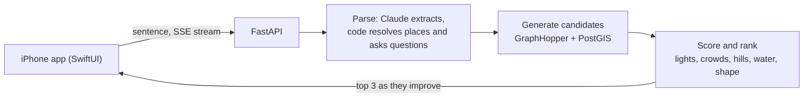

# Loop

[](https://github.com/jaredjgrossi/project_loop/actions/workflows/unit-tests.yml)

Describe a run in a sentence, like "6 mi loop from Kips Bay, mostly waterfront, I wait at lights", and get real New York City routes that fit it. Each one is scored with NYC data, and Loop says so when a limit can't be met.

Claude reads the sentence. Code decides everything else. The model never draws a route or produces a number: it turns words into a typed request and says whether a place is outside New York. Code names each route and writes every line the runner reads. Routing and scoring are deterministic, so a route that's wrong becomes a failing test, not a prompt tweak.

## How it works



1. **Parse.** One Claude Haiku call fills a strict schema (distance, start, places to pass, preferences). Code looks every place up, applies the rules, and asks one clarifying question when it can't be sure. It never guesses.
2. **Generate.** Several generators propose routes from the start: grid-aligned loops, out-and-backs, waterfront and park corridors, laps of a named loop, one-way runs. GraphHopper routes them along real paths and streets.
3. **Score.** Each candidate gets measured values: signals per mile, expected wait at lights, crowds (scheduled ferry and school pulses, sidewalk counts), hills, share on water or in parks, shape.
4. **Rank and stream.** The best three reach the phone while the search is still running. Every value carries a source and a trust word (`measured`, `estimate`, `listed`, `verified` or `not scored`).

### Rules the product keeps
- The LLM never generates geometry or numbers, and writes none of the words the runner reads.
- Every amenity, fact and scored value has a source and a trust word.
- If a limit can't be met, Loop returns the nearest route and how far off it is. It never relaxes a limit quietly.
- If parsing fails validation, Loop asks a question.

## Where it stands

| | |
|---|---|
| Parse evals (live Claude, 63 cases) | 59 of 60 on the last full run (2026-11-14); the three outside-New-York cases added since pass on three runs in a row. A handful of cases vary between runs |
| Cost of reading a sentence | about $0.00026 (Claude Haiku 5.5), median 1.5 s |
| First route on the phone | about 1.3 s median; the full search takes longer and keeps improving the top 3 |
| Pinned top 3 for 30 start and distance pairs | 30 of 30 match the pinned results |
| Unit tests | 1,392, none needing a database or network in CI |
| Live route, place, crowd and parse-harness evals | 395 of 396 on the last full run (2026-11-12), against the real stack on the Mac (one needs private run data and skips) |

Every bad route that turns up in testing becomes a case in [`evals/routes/test_rejected_routes.py`](evals/routes/test_rejected_routes.py).

## Things I decided and why
The reasoning is in [`docs/decisions/`](docs/decisions/), one short note per choice. Four to start with:
- [018: generation speed](docs/decisions/018-generation-speed.md): stream the best three early, then keep improving them.
- [021: counting traffic lights](docs/decisions/021-once-per-crosswalk-favors-out-and-backs.md): once per crosswalk, and why that favors out-and-backs.
- [028: the parser](docs/decisions/028-parser-haiku-extraction.md): one cheap extraction, then rules.
- [044: honest kinds and no padding](docs/decisions/044-honest-kinds-spurs-loop-climb.md) and [045](docs/decisions/045-waypoint-spurs.md): name a route by what it measures, and never stretch a run with a quick out-and-back.

## What I'd do next
- Plan restroom and water stops. The data is loaded, but Loop says it can't plan them yet instead of ignoring the request.
- Count the climb of bridges. The elevation source is a ground model, so a bridge reads as the river under it.
- Host it off the Mac, with a key per install, a retention limit on stored routes and a way to delete your data.
- Run the live evals on a schedule, so one going stale can't sit unnoticed.

## What's here

```
api/       FastAPI server, parser, route generators, scoring and ranking, GPX export
ios/       the iPhone app (SwiftUI, Mapbox); see ios/README.md
etl/       NYC Open Data and OpenStreetMap into PostGIS: places, landmarks, corridors, closures, crowds
routing/   GraphHopper config and the custom foot model
ci/        keeps the unit tests off the network in CI
evals/     parse evals (live Claude), route, place and crowd evals (live stack)
docs/      the plan, one note per decision, the API contract (phase3/), setup
```

## Run it
[`docs/SETUP.md`](docs/SETUP.md) has the whole setup for a Mac: Docker, the NYC map, the database, `make serve`.

Data: NYC Open Data (parks, fountains, restrooms, neighborhoods, school calendars, pedestrian counts, subway ridership), NYC Ferry and SeaStreak schedules; map data © OpenStreetMap contributors via Geofabrik; addresses from NYC Planning Labs GeoSearch. Every loaded row keeps its source dataset ID, source row ID and load time.
